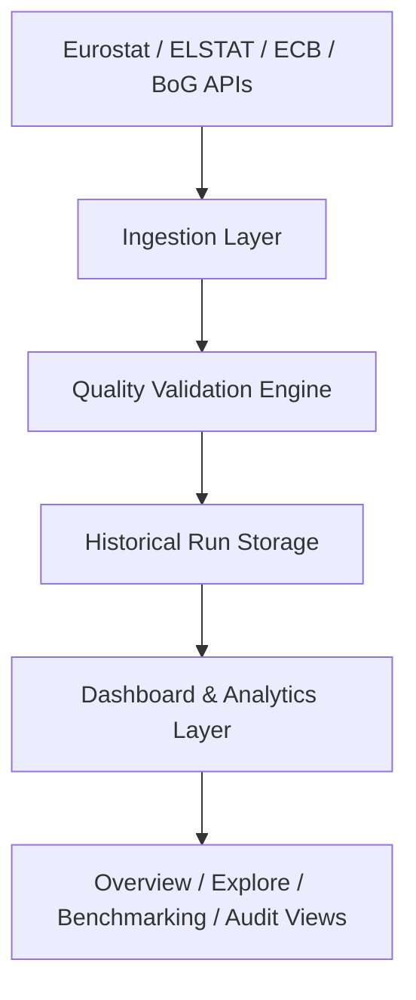

# Greek Public Data Quality Monitor 🇬🇷

A production-style, multi-topic public data quality surveillance platform for official statistics about Greece.

The dashboard helps users understand what is happening across major public-interest domains — economy, people & society, energy & environment, tourism, housing, and banking & finance — and assess how complete, current, and reliable the underlying data is.

Every displayed number comes from a documented official source (Eurostat, ELSTAT, the ECB, and the Bank of Greece), with its unit, reporting frequency, source authority, and reference period. We avoid placeholder values, invented observations, and hardcoded metrics.

---

## 🚀 Live Demo

- **Deployed Dashboard**: [https://greek-public-data-quality-monitor.streamlit.app](https://greek-public-data-quality-monitor.streamlit.app)

---
## 🎯 Project Overview

Greek Public Data Quality Monitor is an end-to-end public-data monitoring and analytics platform built around a strict numerical truth principle.

It ingests official statistical series, validates them against known quality rules, stores historical snapshots, and exposes them through an interactive Streamlit dashboard for exploration and audit reporting.

### Who this is for
- Policy analysts and economists tracking Greece’s macroeconomic and social indicators.
- Data journalists and researchers comparing official series across time.
- Data engineering portfolio builders who want a reproducible ETL + validity-monitoring workflow.
- Anyone who wants a transparent view of how official statistics are changing and whether they are fresh, complete, and reliable.

### What the project delivers
- A central catalog of 19 official indicators across 6 domains.
- Automated ingestion from Eurostat and related public statistical sources.
- Quality checks for missing data, known gaps, revision risk, and anomalous change patterns.
- Historical run tracking and snapshot-based audit comparisons.
- An interactive dashboard for exploration, benchmarking, and quality review.

---

## 🏗️ System Architecture

The platform uses a simple but robust architecture built on Python, official data APIs, and a local SQLite-backed persistence layer.



### Core components
- `src/greek_data_monitor/catalog.py`: central, curated indicator registry.
- `src/greek_data_monitor/ingestion.py`: API fetchers and series normalization.
- `src/greek_data_monitor/quality.py`: data-quality inspection and rule evaluation.
- `src/greek_data_monitor/store.py`: database persistence for runs, observations, and snapshots.
- `src/greek_data_monitor/dashboard_service.py`: KPI generation, comparison logic, audit reporting.
- `app.py`: Streamlit application UI.
- `src/greek_data_monitor/cli.py`: command-line interface for ingestion and auditing.

---

## 📚 Indicator Catalog

The project centralizes 19 official statistical indicators across six domains.

| Domain | Indicator | Dataset Code | Dimension Key | Unit | Source |
|---|---|---|---|---|---|
| 🏛️ Economy | GDP (Nominal) | `nama_10_gdp` | `A.CP_MEUR.B1GQ.EL` | Current Prices (€M) | Eurostat |
| 🏛️ Economy | GDP (Real) | `nama_10_gdp` | `A.CLV20_MEUR.B1GQ.EL` | Chain-linked 2020 (€M) | Eurostat |
| 🏛️ Economy | Inflation Rate (HICP) | `prc_hicp_aind` | `A.RCH_A_AVG.CP00.EL` | Annual Rate of Change (%) | Eurostat |
| 🏛️ Economy | Unemployment Rate | `une_rt_a` | `A.Y15-74.PC_ACT.T.EL` | % of active population | Eurostat / ELSTAT |
| 🏛️ Economy | Public Debt | `gov_10dd_edpt1` | `A.PC_GDP.S13.GD.EL` | % of GDP | Eurostat |
| 🏛️ Economy | Exports of Goods & Services | `nama_10_gdp` | `A.CP_MEUR.P6.EL` | Current Prices (€M) | Eurostat |
| 🏛️ Economy | Imports of Goods & Services | `nama_10_gdp` | `A.CP_MEUR.P7.EL` | Current Prices (€M) | Eurostat |
| 👥 People & Society | Total Population | `demo_pjan` | `A.NR.TOTAL.T.EL` | Persons | Eurostat / ELSTAT |
| 👥 People & Society | Life Expectancy at Birth | `demo_mlexpec` | `A.YR.T.Y_LT1.EL` | Years | Eurostat / ELSTAT |
| 👥 People & Society | At-Risk-of-Poverty Rate | `ilc_li02` | `A.MED_EI.PC.B_60.T.TOTAL.EL` | % of population | Eurostat / ELSTAT |
| 👥 People & Society | Annual Immigration Inflow | `migr_imm1ctz` | `A.TOTAL.COMPLET.TOTAL.NR.T.EL` | Persons | Eurostat / ELSTAT |
| 👥 People & Society | Annual Emigration Outflow | `migr_emi1ctz` | `A.TOTAL.COMPLET.TOTAL.NR.T.EL` | Persons | Eurostat / ELSTAT |
| ⚡ Energy & Environment | Renewable Energy Share | `nrg_ind_ren` | `A.REN.PC.EL` | % gross final energy | Eurostat |
| ⚡ Energy & Environment | Greenhouse Gas Emissions | `env_air_gge` | `A.THS_T.GHG.TOTXMEMO.EL` | kt CO2 equivalent | Eurostat / EEA |
| ⚡ Energy & Environment | Final Energy Consumption | `nrg_ind_eff` | `A.FEC_EED.MTOE.EL` | MTOE | Eurostat |
| 🏖️ Tourism | Tourist Arrivals | `tour_occ_arnat` | `A.TOTAL.NR.I551-I553.EL` | Arrivals (persons) | Eurostat / ELSTAT |
| 🏖️ Tourism | Tourist Overnight Stays | `tour_occ_ninat` | `A.TOTAL.NR.I551-I553.EL` | Nights | Eurostat / ELSTAT |
| 🏠 Housing | House Price Index | `tipsho20` | `A.I15_A_AVG.EL` | Index (2015=100) | Eurostat / Bank of Greece |
| 🏦 Banking & Finance | 10Y Government Benchmark Yield | `irt_lt_mcby_a` | `A.MCBY.EL` | % p.a. | Eurostat / ECB |

---

## 🖥️ Interactive Dashboard

Run the application locally:

```bash
python -m pip install -r requirements.txt
streamlit run app.py
```

Open: `http://localhost:8501`

For Streamlit Community Cloud, select `app.py` as the entrypoint. The root
`requirements.txt` installs the local `greek_data_monitor` package and its dashboard
dependencies using the setuptools configuration in `pyproject.toml`. Keep this
file in the deployment branch so Community Cloud uses it instead of attempting
to install this setuptools project with Poetry.

The dashboard includes several focused pages:

1. Overview
   - Key multi-domain KPI cards.
   - Latest value, reference period, source, freshness, and year-over-year changes.
   - Trend views across macroeconomic and social themes.

2. Explore Data
   - Search, filter, and compare indicators.
   - Safe comparison logic with unit-aware indexing and guarded normalization.
   - Anomaly and quality insights.

3. Greece in Context
   - Compare Greece against EU and peer-country contexts.
   - Timeline and benchmark views.

4. Fiscal & Debt Surveillance
   - Highlight debt and macro-financial indicators.

5. Cross-Series Analysis & Lab
   - Investigate relationships between indicators and key statistical signals.

6. Data Quality & Freshness
   - Quality scorecards and lifecycle status.
   - Findings for missing, stale, and structurally unusual periods.

7. Audit Reports & Data Export
   - Executive summary markdown and persistence export flows.

8. Sources & Methodology
   - Catalog references, methodology notes, and source transparency.

---

## 🔎 Data Quality & Validation Logic

The platform does not simply fetch data and plot it. It actively validates it.

### Quality checks include
- Missing period detection and structural gap recognition.
- Change metric evaluation based on whether the indicator is a rate, level, or non-comparable series.
- Guarded comparison logic to avoid misleading normalization when the base value is zero or invalid.
- Snapshot-based revision detection and historical run comparison.
- Inventory of `INFO`, `WARN`, and `ERROR` findings.

### Statistical safeguards
- Rate metrics use change metrics such as `percentage_points` when appropriate.
- Relative percent changes are suppressed when prior values are zero or near-zero.
- Known structural missing periods are explicitly documented instead of being treated as data failures.
- Comparison indexes are blocked when the baseline is invalid, missing, or non-finite.

---

## 🔄 Data Pipeline

The ingestion and monitoring workflow is designed to be reproducible and resilient.

1. Data source retrieval
   - Fetches official series via Eurostat and related APIs.
   - Stores raw observations and metadata.

2. Quality inspection
   - Validates period coverage, prior changes, missing records, and anomaly conditions.

3. Persistence and snapshots
   - Saves runs and findings in the local database.

4. Dashboard analysis
   - Builds KPI cards, trend charts, and comparison views.

5. Audit reporting
   - Produces human-readable summaries for review and export.

---

## 📡 Data Sources

The software is connected to officially published public data sources, especially:

- Eurostat
- ELSTAT
- European Central Bank (ECB)
- Bank of Greece

These sources provide the reference series used in the catalog, including GDP, inflation, unemployment, POVERTY, tourism, housing, population, and energy indicators.

---

## 🧪 Testing and Reliability

The project uses an offline-friendly test suite driven by mocks and deterministic fixtures.

```bash
pytest -v
```

The suite covers:
- Catalog integrity and indicator metadata.
- Change metric logic and zero/near-zero handling.
- Structural missing periods and quality classification.
- Comparison and index safety checks.
- Database persistence and run history behavior.
- CLI behaviors for catalog, run, and history workflows.

---

## ⚙️ Installation

Requires Python 3.11+.

```bash
git clone https://github.com/andreastsakiris/Greek-Public-Data-Quality-Monitor.git
cd Greek-Public-Data-Quality-Monitor

python3 -m venv .venv
source .venv/bin/activate

pip install -e .
pip install -e ".[test]"
```

The package exposes CLI commands:

```bash
greek-data-monitor --help
gdm --help
```

---

## 🚀 CLI Commands

### Ingest all catalog indicators

```bash
gdm run --all
```

### Ingest a specific indicator

```bash
gdm run --series unemployment_rate
gdm run --series house_price_index
```

### View the central catalog

```bash
gdm catalog
```

### Inspect recent runs

```bash
gdm history --limit 10
gdm history --run-id 6
```

---

## 📁 Project Structure

```text
Greek-Public-Data-Quality-Monitor/
├── app.py
├── README.md
├── pyproject.toml
├── src/
│   └── greek_data_monitor/
│       ├── __init__.py
│       ├── catalog.py
│       ├── cli.py
│       ├── config.py
│       ├── dashboard_service.py
│       ├── ingestion.py
│       ├── quality.py
│       └── store.py
├── tests/
│   ├── test_catalog.py
│   ├── test_cli.py
│   ├── test_dashboard_service.py
│   ├── test_ingestion.py
│   ├── test_multi_country_ingestion.py
│   ├── test_quality.py
│   └── test_store.py
├── data/
├── outputs/
├── work/
└── .venv/
```

---

## 📌 Transparency & Scope

The project is intentionally explicit about what it does and does not cover.

Where an indicator lacks a clean public API or official machine-readable source, the project documents that limitation rather than inventing values.

Examples include:
- tourism receipts without direct public REST coverage.
- lending-rate series with multipliers and subcategory complexity.
- energy-price dissemination that is periodic, not annualized across every market dimension.

This keeps the project honest and aligned with official publication practices.

---

## 🧭 Key Principles

The project is built on four principles:

1. Numerical truth before storytelling.
2. Transparent provenance for every indicator.
3. Quality checks that distinguish between structural gaps and real problems.
4. Reproducibility through code, versioned logic, and run history.

---

## 📄 License

The code is licensed under the MIT License. Statistical data is reused according to the relevant official public data terms and licensing policies from Eurostat, ELSTAT, the ECB, and the Bank of Greece.

---

## 👨‍💻 Author

Andreas Tsakiris

- GitHub: https://github.com/tsakirisand

